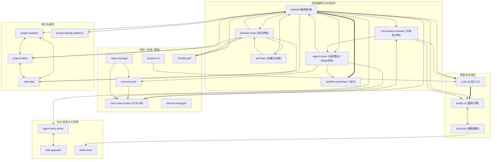

# `solo-skills` 全量审查、优化方案与落地记录

> 审查基准：`2026-11-23`（覆盖全仓 24 个在役 skill、仓级 `scripts/`、`tests/`、`docs/`、`README.md`、`AGENTS.md`、`Makefile`、`archive/README.md`）
>
> 本文汇总对 `solo-skills` 的系统性审查（各 skill 意图与边界、skill 间联动拓扑）、三层优化方案（v1 草案）、对抗性二次审查裁决，以及 Phase 1–3 落地后的前后对比与验收结果。

---

## 一、核心结论摘要

`solo-skills` 单个 skill 的工程纪律已经相当扎实（动态路由、渐进披露、8KB 软预算、运行时只读、`archive/README.md` 旧名注册表与契约单测）。本轮审查识别出的核心短板集中在**系统级拓扑与治理演进缝隙**：

1. **核心枢纽失联**：[taskrail](../skills/taskrail/SKILL.md) 作为唯一编排入口，原正文与全部 25 个 `references/` 中对 `role-based-reviewer`、`solo-code-review`、`agent-roster`、`session-wrap`、`project-design-patterns`、`anti-lazy` 均为 **0 命中**。
2. **双头编排与外部依赖偏重**：[agent-roster](../skills/agent-roster/SKILL.md) 的 `flow` 模式维护独立的 `3-Track × 6-Stage` 编排与 spine 状态，且单独拉入 3 个仓外依赖（`grilling`、`grill-with-docs`、`domain-modeling`）。
3. **硬依赖组过重**：因采用 Markdown 相对路径链接，`taskrail` 与 `role-based-reviewer` 被迫硬绑定 `ui-kit` + `pretty-ui`，纯后端/通用用户无法轻装安装。
4. **局部双入口与单向边界**：`project-init` 前端栈不知 `ui-kit`、`pretty-ui` 不知 `visualize`、`solo-code-review` 不指回 `role-based-reviewer`、`trouble-grill` 不指向 `session-wrap`、`project-design-patterns` 0 入度孤岛化。
5. **治理漂移与 8KB 贴线**：5 个 skill 紧贴 8192B 上限（8011–8094B）；`version` 约定仅 1/24 落地；`lark-cli` 缺少契约单测；`role-chat` 示例含真实 role-id 笔误（`roles=product` vs 注册表 `product-manager`）。

---

## 二、24 个 Skill 意图全景（优化后基线）

| 域 | Skill | 优化前 | 优化后 | DMI | 单测 | 核心意图与定位 |
|---|---|---:|---:|:---:|:---:|---|
| **任务编排** | [taskrail](../skills/taskrail/SKILL.md) | 5,491 B | 5,601 B | - | 23 | 唯一任务编排入口：台账、动态路由、父子拆解、评审分流、验证与收口 |
| **任务编排** | [taskflow](../skills/taskflow/SKILL.md) | 3,910 B | 3,910 B | - | 7 | 代码执行与 worktree 隔离（direct / OpenSpec 适配器，与 `taskrail` 成核心双件套） |
| **任务编排** | [role-based-reviewer](../skills/role-based-reviewer/SKILL.md) | 3,709 B | 3,838 B | - | 2 | 10 岗位多视角只读评审 / 咨询（`mode=review\|ask`） |
| **任务编排** | [anti-lazy](../skills/anti-lazy/SKILL.md) | 2,346 B | 2,489 B | - | 1 | 无台账任务的四问元检查（意图/现场/差距/收口），明确升格到 `taskrail` / `session-wrap` |
| **任务编排** | [session-wrap](../skills/session-wrap/SKILL.md) | 8,033 B | 7,447 B | - | 1 | 会话级两轮收尾（清点、合入建议、衍生分流、知识路由、弯路复盘） |
| **跨 Agent** | [agent-roster](../skills/agent-roster/SKILL.md) | 8,088 B | 7,370 B | - | 4 | 跨机器 / Endpoint 名册与受控委派；`flow` 明确限定于按 Stage 跨 Endpoint 派单 |
| **代码仓库** | [commit-push](../skills/commit-push/SKILL.md) | 5,919 B | 5,919 B | - | 1 | 单仓变更分析、冲突分流、密钥扫描、提交与推送 |
| **代码仓库** | [project-explore](../skills/project-explore/SKILL.md) | 7,303 B | 6,913 B | - | 2 | 只读项目理解与代码取证，持久化路由至 `project-atlas` / `wiki-data` |
| **代码仓库** | [solo-code-review](../skills/solo-code-review/SKILL.md) | 8,094 B | 7,531 B | - | 2 | 基于 OCR CLI 的 Git diff / MR / PR 自动化审查与落盘 |
| **代码仓库** | [repo-manager](../skills/repo-manager/SKILL.md) | 6,028 B | 6,028 B | - | 1 | 基于 `grepom` / `glab` 的多仓批量生命周期与工作区卫生 |
| **代码仓库** | [project-init](../skills/project-init/SKILL.md) | 7,042 B | 7,042 B | - | 1 | 脚手架新建（`init`）或架构对齐（`align`）；前端 React 模板路线衔接 `ui-kit` |
| **代码仓库** | [service-manager](../skills/service-manager/SKILL.md) | 3,470 B | 3,470 B | - | 1 | 项目本地服务 `list/start/stop/restart/status/logs` 与台账 |
| **代码仓库** | [lark-cli](../skills/lark-cli/SKILL.md) | 3,651 B | 3,651 B | `true` | 1 | 飞书官方 CLI 内嵌 skill 的薄路由器（防上下文膨胀） |
| **界面设计** | [ui-kit](../skills/ui-kit/SKILL.md) | 5,694 B | 5,694 B | - | 1 | 默认 Web UI 总入口（分派 `pretty-ui` 通用路线 vs React 模板路线） |
| **界面设计** | [pretty-ui](../skills/pretty-ui/SKILL.md) | 7,222 B | 7,367 B | - | 2 | 通用 UI 设计、实现、截图打磨、评审与文字为主阅读页 |
| **界面设计** | [visualize](../skills/visualize/SKILL.md) | 5,609 B | 5,609 B | - | 1 | 内容可视化编排：视觉简报 → `archify` / `visual-explainer` → 核对与降级 |
| **设计模式** | [project-design-patterns](../skills/project-design-patterns/SKILL.md) | 2,100 B | 2,100 B | - | 2 | 跨项目可复用设计模式卡库（含 `agent-api-ops` 操作规范，`version: 1.1.0`） |
| **知识内容** | [wiki-data](../skills/wiki-data/SKILL.md) | 8,091 B | 7,283 B | - | 2 | 本地 Markdown 知识 wiki（来源、置信度、时效、经验与台账） |
| **知识内容** | [project-atlas](../skills/project-atlas/SKILL.md) | 7,178 B | 7,178 B | - | 2 | 源码映射的项目架构/业务金字塔文档 + `_site/` 静态站 + 自愈 |
| **知识内容** | [role-chat](../skills/role-chat/SKILL.md) | 5,803 B | 5,811 B | `true` | 1 | 多视角角色对话陪练（金融/开发/架构/产品/英语陪练） |
| **Skill 工具** | [skills-store](../skills/skills-store/SKILL.md) | 6,687 B | 6,687 B | - | 1 | `npx skills` 管理 + 外部 skill 安装前安全审计门禁 |
| **Skill 工具** | [agent-docs-writer](../skills/agent-docs-writer/SKILL.md) | 4,136 B | 4,136 B | - | 1 | 从零新建 Skill、维护 `AGENTS.md`/`CLAUDE.md`、只读评审 |
| **Skill 工具** | [skill-upgrader](../skills/skill-upgrader/SKILL.md) | 8,011 B | 7,522 B | - | 2 | 可审计更新已有 Skill（`update` / `self-upgrade` / `evolve`，全仓最高入度） |
| **Skill 工具** | [trouble-grill](../skills/trouble-grill/SKILL.md) | 7,437 B | 7,567 B | - | 1 | 复杂根因排查自拷问（可证伪锚点 + 假设板 + 四道门 + 落盘） |

---

## 三、Skill 间联动拓扑（优化后）

下图中：**粗实线**为 README「依赖组」中仅剩的 3 条强相对路径依赖（`taskrail ⇔ taskflow`、`ui-kit ⇒ pretty-ui`）；**普通实线**为按名或可选文件锚点软联动（未安装下游时按正文降级，同时由 `tests/test_cross_skill_refs.py` 校验源仓存在性）。

---

## 四、优化方案（v1）与二次红队审查裁决

针对初版 10 项优化提案，从「设计原则一致性、8KB 预算与上下文隔离、向后兼容与 `dotf` 生态、爆炸半径与 ROI」四个维度做二次红队审查后的最终裁决：

| 提案 | v1 草案 | 二次审查裁决 | 裁决理由与终版落地形态 |
|---|---|:---:|---|
| **P0-4** | 合并 `taskrail` 与 `taskflow` | 驳回 | 合并后 `SKILL.md` 达 9.4KB 突破红线，且破坏多 worker 场景下「只载 `taskflow`、不载 `taskrail` 编排上下文」的 token 隔离。保留核心双件套，在 README 显式标明原子安装组合。 |
| **P0-1** | 直接归档 `agent-roster flow` | 修订 | `flow` 的「按 Stage 弹菜单选 Endpoint + Model」能力尚无直接替代。改分两步：本轮先明确与 `taskrail` 边界并把 `mattpocock/skills` 三件套降级为可选依赖；待 `taskrail` 原生集成 Stage/Endpoint 派单后再归档。 |
| **P0-2** | 补齐 `taskrail` 枢纽出链 | 修订 | 严控 `taskrail/SKILL.md` 不膨胀：主文件仅新增 `review.md` 直链，其余 4 条软指针（`agent-roster`、`project-design-patterns`、`session-wrap` 及评审分流）全部下沉至按需加载的 `references/`，普通小任务零日常 token 增量。 |
| **P0-3** | 解除 `ui-kit`/`pretty-ui` 硬依赖 | 修订 | 避免纯散文引用丢失断链保护：将相对链接改为反引号可选文件锚点（如 `` `pretty-ui/references/rules.md` ``）+ 未安装降级句，同时在 `tests/test_cross_skill_refs.py` 新增源仓存在性静态校验。 |
| **P1-1** | `project-init` 前端接 `ui-kit` | 保留 | 在 `project-init/references/frontend.md` 补齐 React 模板路线（`ui-template.lock.json`）与后续设计语言到 `ui-kit` 的路由衔接。 |
| **P1-2** | 5 组双向边界 + 共享清单 | 修订 | 落地全部双向边界并修 `role-chat` 笔误；**放弃**跨 skill 共享检查清单或 `archify` 公共文件，避免制造新的硬依赖组。 |
| **P1-3** | 明确 `anti-lazy` 升格出口 | 保留 | 补充到 `taskrail`（跨会话台账）与 `session-wrap`（会话收尾）的一句边界指针，维持轻量定位。 |
| **P2-1** | 5 个贴 8KB Skill 精准瘦身 | 保留 | 在不触碰 `gate_lines.txt` 锁行与所有契约断言前提下，全部压回 `≤ 7.55KB`。 |
| **P2-2** | 全量补 `version` / 扩 DMI / 删 `{{slash}}` | 修订 | 避开 3 个坑：不盲扩 `disable-model-invocation: true`（防止自然语言触发漏触）；不破坏 `dotf` 的 `{{slash:...}}` 并在 `test_cross_skill_refs.py` 纳管校验；更新 `AGENTS.md` 将 `version` 明确为按需字段。 |
| **P2-3** | `lark-cli` 单测与卫生修补 | 保留 | 补齐 `skills/lark-cli/tests/test_lark_cli_contract.py`、修正 `check_output_style.py` 旧注释、修正 `skills/solo-code-review` 权限为 `0755`。 |

---

## 五、Phase 1–3 落地清单与验收结果

### 5.1 已落地 Skill Patches（严格按 `skill-upgrader` 协议留痕）

| 批次 | Skill | Patch ID | 核心改动 |
|---|---|---|---|
| Phase 1 | `role-chat` | `20261123-200100-fix-role-id-example` | 修正示例 `roles=product,finance` → `roles=product-manager,finance`，补齐注册表一致性断言 |
| Phase 1 | `lark-cli` | `20261123-200200-add-contract-tests` | 新增 `tests/test_lark_cli_contract.py`（实现 24/24 skill 单测全覆盖） |
| Phase 1 | `wiki-data` | `20261123-200300-trim-skill-md` | 精简重复阶段小节与「非目标」，8091B → 7283B |
| Phase 1 | `session-wrap` | `20261123-200400-trim-skill-md` | 紧凑合并第 3/4 节与「确认与授权」，8033B → 7447B |
| Phase 1 | `project-explore` | `20261123-200500-trim-evolution-boilerplate` | 压缩文末「经验回灌」样板为紧凑指针，7303B → 6913B |
| Phase 1 | `solo-code-review` | `20261123-200600-trim-and-rbr-boundary` | 补齐 `role-based-reviewer` 边界指针并瘦身，8094B → 7531B（同步修复目录权限 `0755`） |
| Phase 1 | `skill-upgrader` | `20261123-202300-trim-skill-md` | 精简非锁行重复说明，8011B → 7522B |
| Phase 2 | `taskrail` | `20261123-201000-hub-closure-references` | 新增 `references/review.md`，在 `confirm-protocol`/`design`/`close` 下沉 4 条软出链 |
| Phase 2 | `role-based-reviewer` | `20261123-201100-clarify-adjacent-boundaries` | 补齐 `solo-code-review` 与 `role-chat` 边界 |
| Phase 2 | `project-init` | `20261123-201200-connect-ui-kit-frontend` | `references/frontend.md` 衔接 `ui-kit` 与 `ui-template.lock.json` |
| Phase 2 | `pretty-ui` | `20261123-201300-add-visualize-boundary` | 路由节补齐向 `visualize` 的图解双向边界 |
| Phase 2 | `trouble-grill` | `20261123-201400-connect-session-wrap-detour` | 落盘节补齐向 `session-wrap` 弯路复盘的衔接 |
| Phase 2 | `anti-lazy` | `20261123-201500-clarify-escalation-boundaries` | 补齐向 `taskrail` 与 `session-wrap` 的升格出口 |
| Phase 3 | `taskrail` | `20261123-202000-decouple-ui-hard-links` | 将 `ui-kit`/`pretty-ui` 相对链接改为可选文件锚点 + 降级说明 |
| Phase 3 | `role-based-reviewer` | `20261123-202100-decouple-ui-hard-links` | 将 `design.md` 的 `pretty-ui`/`ui-kit` 相对链接改为可选文件锚点 + 降级说明 |
| Phase 3 | `agent-roster` | `20261123-202200-trim-and-optional-matt-deps` | 明示与 `taskrail` 边界、`$grill-with-docs` 改可选并瘦身，8088B → 7370B |

### 5.2 仓级配套更新

- [README.md](../README.md) & [AGENTS.md](../AGENTS.md) & [Makefile](../Makefile)：
  - 依赖组从 6 条硬边收敛为仅 3 条必要硬边（`taskrail ⇔ taskflow`、`ui-kit ⇒ pretty-ui`）。
  - `grilling` / `grill-with-docs` / `domain-modeling` 降级为可选外部依赖，不再阻断 `make check-deps`。
  - `AGENTS.md` 对齐 `version`（按需声明）与 `disable-model-invocation: true`（仅高误触代价 + 显式点名）的清晰标准。
- [tests/test_cross_skill_refs.py](../tests/test_cross_skill_refs.py)：新增 `{{slash:<name>}}` 校验与可选跨 skill 文件锚点存在性校验。
- [scripts/check_output_style.py](../scripts/check_output_style.py)：修正残留旧概念注释 `wizard/intent.md` → `intent.md`。

### 5.3 关键指标前后对比

| 指标 | 优化前 | 优化后 |
|---|---:|---:|
| 紧贴 8KB 红线（> 8000B）的 Skill 数 | 5 个（最高 8094B） | **0 个**（最高 7567B） |
| 拥有契约单测的 Skill 覆盖率 | 23 / 24（缺 `lark-cli`） | **24 / 24** |
| 跨 Skill 硬相对路径依赖边 | 6 条（捆绑 UI 引擎） | **3 条**（仅 `taskrail ⇔ taskflow`、`ui-kit ⇒ pretty-ui`） |
| `taskrail` 可达下游 Skill 数 | 9 个 | **14 个**（主文件仅增 110B） |
| 0 入度孤岛 Skill 数 | 6 个 | **2 个**（仅刻意独立的 `lark-cli`、`repo-manager`） |
| `make check-deps` 必选仓外 Skill 数 | 7 个 | **4 个**（仅 `openspec-*`） |
