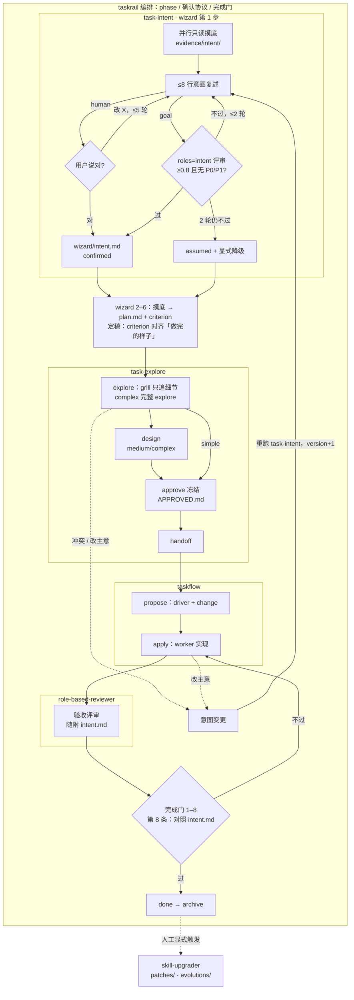

# task 系列：流程与使用

一页说清 task 系列怎么串、怎么用。规则真源在各 skill 文件里（下文标「来源」）；本文与之冲突时以真源为准，契约总真源是 [skills/taskrail/references/contract.md](../../skills/taskrail/references/contract.md)。

## 1. 各 skill 干什么

| skill | 一句话 | 来源 |
|---|---|---|
| `taskrail` | **唯一编排入口**：绑定 `tasks/` 台账，按阶段推进，持确认协议、门包、完成门 | `skills/taskrail/SKILL.md` |
| `task-intent` | 开工前确认「你要什么」：并行摸底 → ≤8 行复述 → 纠偏到确认 | `skills/task-intent/SKILL.md` |
| `task-explore` | 探索台账命令：explore（grill）/ design / approve / handoff / archive 等 | `skills/task-explore/SKILL.md` |
| `taskflow` | 交接后执行：建 `{task}-driver`，拆 OpenSpec change，进度只认 checkbox | `skills/taskflow/SKILL.md` |
| `role-based-reviewer` | 按岗位只读评审；`roles=intent` 审意图复述，交付验收按门包角色打分 | `skills/role-based-reviewer/SKILL.md` |
| `skill-upgrader` | 改 skill 本身：`update` 写 `patches/`，`evolve` 写 `evolutions/`（仅显式触发） | `skills/skill-upgrader/SKILL.md` |

## 2. 流程图



来源：`taskrail/references/phase-wizard.md`（步骤 1、6）、`task-intent/references/*`、`taskrail/SKILL.md`「完成门」、`taskrail/references/contract.md`「意图变更」。

## 3. human 与 goal

| | human（默认） | goal |
|---|---|---|
| 触发 | 未命中 goal | 消息含 `/goal` 或 `goal:` 前缀 |
| 意图确认 | 你看复述，说「对」或「哪里不对」；第 3 轮收成二选一；硬上限 5 轮 | 异源、高一档模型经 `roles=intent` 代审；最多 2 轮，不过则 `assumed` + 显式降级继续 |
| 闸口 | 列选项（含推荐）等你确认 | 写推荐默认 → 派审 → 收敛即同轮继续 |
| 永远停下等人 | 线上、泄密、未点名危险操作、A 类 `pending` 降级、不可逆或对外发送 | 同左 |

来源：`taskrail/references/confirm-protocol.md`、`task-intent/references/correction-loop.md`、`goal-review.md`。

## 4. 档位

| 档位 | 典型 | 路径（wizard 之后） | 意图摸底 |
|---|---|---|---|
| simple | 局部修改 | explore(仅 grill) → approve(轻) → handoff → propose(单切片) → apply → archive | 1 个；原话已清晰可跳过 |
| medium | 跨模块 / 仓库 | explore(仅 grill) → design(可轻) → approve → handoff → propose → apply → archive | 2–3 个并行 |
| complex | 项目级重构、涉及面广 | explore(+grill) → design → approve → handoff → propose → apply → archive | 3–4 个并行 |

凡经 taskrail 都走 handoff + OpenSpec（simple 也是）。来源：`taskrail/references/contract.md`、`phase-wizard.md`「复杂度档位」。

## 5. subagent 派发

- **默认派出**；宿主没有 subagent 就主会话自做，不停下；有能力不派要写一句理由。
- **不派**：闸口、面向你的提问、危险退出；一句话能说清或 <30 行的活；拆不开的步骤。
- **上限**：simple 1、medium 3、complex 5；同批一次性并行。
- **交接 5 项**：目标、输入路径、写入范围、输出格式、停止条件。
- **Digest ≤10 行**：结论 / 落盘路径 / 未决 / 置信度；详情落盘，主会话不转贴全文。

来源：`taskrail/references/contract.md`「执行座位」、`task-intent/references/probe.md`。

## 6. 关键产物

| 路径（`tasks/ongoing/{slug}/` 下） | 谁写 | 用途 |
|---|---|---|
| `TASK.md` | taskrail | `phase` / `confirm_mode` / `tier` / `criterion`，单任务真相 |
| `wizard/intent.md` | task-intent | 确认版意图（`status` / `version` / 历史版本 / 纠偏记录） |
| `evidence/intent/` | 摸底 subagent | 摸底详情 |
| `wizard/plan.md` | wizard | 方案、完成判据、流程总览、交付类别与门包 |
| `explore/`、`design/` | task-explore | grill 纪要、设计稿（`design/contract.md` 命中门包时） |
| `approve/APPROVED.md` | task-explore | 冻结方案 |
| `{slug}-driver` | taskflow | OpenSpec driver 与子 change；进度只认 checkbox |

`tasks/INDEX.md` 是派生索引，不是第二份真相。来源：`taskrail/references/contract.md`「目录」。

## 7. 怎么用

```text
taskrail <一句话目标>          # 新任务（human）
taskrail goal: <一句话目标>    # 新任务（goal）
taskrail resume [slug]         # 恢复：输出 目标 / phase / 未决 / 建议下一步
taskrail list                  # 列任务
```

- 单点用 task-explore：`{{slash:task-explore}} <命令>`，命令见其「命令」表（`new` / `explore` / `chat` / `resume` / `design` / `approve` / `save` / `handoff` / `archive` / `reopen` / `expand`）。泛指推进、resume、`/goal` 一律走 taskrail。
- 单独评审：`{{slash:role-based-reviewer}} roles=engineer,sre mode=review 服务与部署变更`。
- 改 skill：点名 `skill-upgrader`（`update` / `evolve`）。

来源：`taskrail/SKILL.md`「输入」、`task-explore/SKILL.md`「命令」、`role-based-reviewer/references/inference-and-speed.md`。

## 8. 中途改主意（意图变更）

1. 重跑 task-intent，`intent.md` 的 `version` +1，旧版留在「历史版本」。
2. 「做完的样子」变了 → 走确认协议**显式**改 `criterion` 并记决策（唯一合法改写）。
3. 未交接：只改细节留在当前 phase；改范围 / 判据回 `wizard` 或 `design`，已 approve 的须重新 approve。
4. 已交接：经 taskflow 开修订子 change，未勾的按新判据重排。

来源：`taskrail/references/contract.md`「意图变更」。

## 9. FAQ

- **会不会问很多？** 只在歧义改变做法或范围时问，且每次最多 1 个、带推荐答案；能查到的不问（`task-intent/SKILL.md`）。
- **grill 会重复问目标吗？** 不会；确认过的目标、做完的样子、不做 不重问（`task-explore/references/explore-design.md`）。
- **怎么算做完？** 完成门 8 条逐条机械核对，第 8 条回看 intent.md；checkbox 全勾但判据不成立不算 done（`taskrail/SKILL.md`）。
- **goal 评审模型用不了？** task-intent 先判断，不可用就登记显式降级后自审，假设全标「把握低」（`goal-review.md`）。
- **小改也要走全套？** 一句话能说清、范围清楚、马上实现的，不必经 taskrail，直接实现或用 taskflow（`task-explore/SKILL.md`「何时不用」）。
- **skill 自己会改自己吗？** 不会；只在你显式点名 skill-upgrader 时改（`skill-upgrader/SKILL.md`）。
