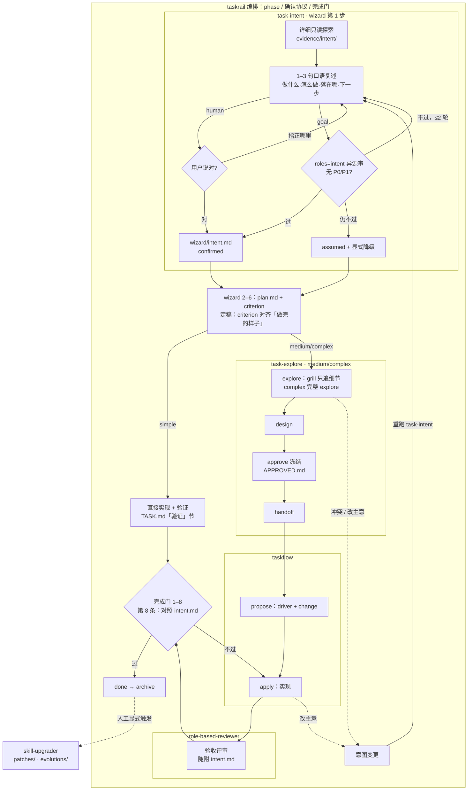

# task 系列：流程与使用

一页说清 task 系列怎么串、怎么用。规则真源在各 skill 文件里（下文标「来源」）；本文与之冲突时以真源为准，契约总真源（含术语）是 [skills/taskrail/references/contract.md](../../skills/taskrail/references/contract.md)。

## 1. 各 skill 干什么

| skill | 一句话 | 来源 |
|---|---|---|
| `taskrail` | **唯一编排入口**：绑定 `tasks/` 台账，按阶段推进，持确认协议、门包、完成门 | `skills/taskrail/SKILL.md` |
| `task-intent` | 开工前对齐意图：详细探索上下文 → 1–3 句口语复述（做什么、怎么做、产出落在哪、下一步）→ 纠偏到确认；结构化覆盖清单只写进 `wizard/intent.md` | `skills/task-intent/SKILL.md` |
| `task-explore` | 探索台账命令：explore（grill）/ design / approve / handoff / archive 等 | `skills/task-explore/SKILL.md` |
| `taskflow` | medium / complex 交接后执行：建 `{task}-driver`，拆 OpenSpec change，进度只认 checkbox | `skills/taskflow/SKILL.md` |
| `role-based-reviewer` | 按岗位只读评审；`roles=intent` 审意图复述，交付验收按门包角色评审 | `skills/role-based-reviewer/SKILL.md` |
| `skill-upgrader` | 改 skill 本身：`update` 写 `patches/`，`evolve` 写 `evolutions/`（仅显式触发） | `skills/skill-upgrader/SKILL.md` |

## 2. 流程图



来源：`taskrail/references/phase-wizard.md`、`task-intent/references/intent.md`、`taskrail/SKILL.md`「完成门」、`taskrail/references/contract.md`「simple 专条」「意图变更」。

## 3. human 与 goal

| | human（默认） | goal |
|---|---|---|
| 触发 | 未命中 goal | 消息含 `/goal` 或 `goal:` 前缀 |
| 意图确认 | 你看一段口语复述（如「好，我按仓库约定写成一份文档……写完告诉你放在哪」），说「对」或指出哪里不对；多轮对不上就换个问法（如二选一） | 异源模型经 `roles=intent` 代审，无 P0/P1 即过；最多两轮，不过则 `assumed` + 显式降级继续；异源模型不可用则登记降级后自审 |
| 闸口 | 列选项（含推荐）等你确认 | 写推荐默认 → 派审 → 收敛即同轮继续 |
| 永远停下等人 | 线上、泄密、未点名危险操作、A 类 `pending` 降级、不可逆或对外发送 | 同左 |

来源：`taskrail/references/confirm-protocol.md`、`task-intent/references/intent.md`。

## 4. 档位

| 档位 | 典型 | 路径（wizard 之后） |
|---|---|---|
| simple | 局部修改 | 直接实现 + 验证 → done（不建 driver、不走 OpenSpec；超出局部即升档 medium） |
| medium | 跨模块 / 仓库 | explore(仅 grill) → design(可轻) → approve → handoff → propose → apply → archive |
| complex | 项目级重构、涉及面广 | explore(+grill) → design → approve → handoff → propose → apply → archive |

Web UI 的重型门（frozen Active Instance + 三条 digest、代表页 two-pass、`ui_evidence_check` 硬门、design 评审文件）只对 complex；medium 为 SHOULD，未做时登记 B 类显式降级。来源：`taskrail/references/contract.md`、`gate-packs.md`。

## 5. subagent 派发

- 大范围摸底、调研、起草、实现切片、评审、验证复跑**宜**派宿主 subagent，并行提速、保持主会话干净。
- 没有 subagent 能力就主会话自做，不停下。
- **永不派出**：闸口、面向你的提问、危险退出。
- 派出时交代目标、输入、写入范围与产出位置；worker 详情落盘，只回简短摘要，主会话不转贴全文。

来源：`taskrail/references/contract.md`「执行座位」。

## 6. 关键产物

| 路径（`tasks/ongoing/{slug}/` 下） | 谁写 | 用途 |
|---|---|---|
| `TASK.md` | taskrail | **唯一任务账**：`phase` / `confirm_mode` / `tier` / `criterion` / 决策；simple 另含「验证」节 |
| `wizard/intent.md` | task-intent | 确认版意图：给你的口语复述原文 + 覆盖清单（要干嘛 / 怎么干 / 输出什么 / 上下文 / 不做 / 假设 / 拍板）+ 纠偏记录 |
| `evidence/intent/` | 探索 | 意图探索详情 |
| `wizard/plan.md` | wizard | 方案、完成判据、流程总览、交付类别与门包 |
| `explore/`、`design/` | task-explore | grill 纪要、设计稿（命中门包时含 `design/contract.md`） |
| `approve/APPROVED.md` | task-explore | 冻结方案 |
| `{slug}-driver` | taskflow | OpenSpec 执行记录（medium / complex）；propose 之后进度看 checkbox |

`tasks/INDEX.md` 是派生索引。来源：`taskrail/references/contract.md`「目录」「TASK.md 元信息」。

## 7. 怎么用

```text
taskrail <一句话目标>          # 新任务（human）
taskrail goal: <一句话目标>    # 新任务（goal）
taskrail resume [slug]         # 恢复：输出 目标 / phase / 未决 / 建议下一步
taskrail list                  # 列任务
```

- 单点用 task-explore：`{{slash:task-explore}} <命令>`，命令见其「命令」表（`new` / `explore` / `chat` / `resume` / `design` / `approve` / `save` / `handoff` / `archive` / `reopen` / `expand`）。泛指推进、resume、`/goal` 一律走 taskrail。
- 单独评审：`{{slash:role-based-reviewer}} roles=engineer,sre mode=review 服务与部署变更`。
- 改 skill：点名 `skill-upgrader`（`update` / `evolve`）。

来源：`taskrail/SKILL.md`「输入」、`task-explore/SKILL.md`「命令」、`role-based-reviewer/references/inference-and-speed.md`。

## 8. 中途改主意（意图变更）

1. 重跑 task-intent，改写 `intent.md` 并追加纠偏记录（旧版靠 git 追溯）。
2. 「做完的样子」变了 → 走确认协议**显式**改 `criterion` 并记决策（唯一合法改写）。
3. 未交接：只改细节留在当前 phase；改范围 / 判据回 `wizard` 或 `design`，已 approve 的须重新 approve。
4. 已交接：经 taskflow 开修订子 change，未勾的按新判据重排。

来源：`taskrail/references/contract.md`「意图变更」。

## 9. 对用户怎么说话

所有直接给你看的话（意图复述、闸口提问、进度、交接与完成通知、评审摘要）都用口语：先说结论或要你做什么，内部术语不裸露或顺带一句白话，不倒「字段：值」清单，最多问一个问题并带推荐，结尾说清接下来会发生什么。落盘文件（`TASK.md`、`intent.md`、driver、评审文件）仍保持结构化。

例：不说「driver checkbox 3/5，slice-2 apply done」，而说「五步里做完了三步，第二部分已经实现并通过测试，接下来做剩下两步」。

来源：`taskrail/references/contract.md`「对用户说话」。

## 10. FAQ

- **会不会问很多？** 只在歧义改变做法或范围时问，一次最多一个、带推荐答案；能查到的不问（`task-intent/SKILL.md`）。
- **会不会满屏术语？** 不会；规则统一在契约「对用户说话」，各 skill 只引用这一处。
- **复述会不会很长、像填表？** 不会：给你的是 1–3 句口语，最多嵌一个问题；字段清单只落在 `wizard/intent.md`，细节在 `evidence/intent/`（`task-intent/references/intent.md`）。
- **grill 会重复问目标吗？** 不会；确认过的目标、做完的样子、不做 不重问（`task-explore/references/explore-design.md`）。
- **怎么算做完？** 完成门逐条机械核对，第 8 条回看 intent.md；判据不成立不算 done（`taskrail/SKILL.md`）。
- **小改也要走全套？** 不用：simple 档定稿后直接实现 + 验证；一句话就能做完、不需要台账的，不必经 taskrail（`taskrail/references/contract.md`、`task-explore/SKILL.md`「何时不用」）。
- **skill 自己会改自己吗？** 不会；只在你显式点名 skill-upgrader 时改（`skill-upgrader/SKILL.md`）。
