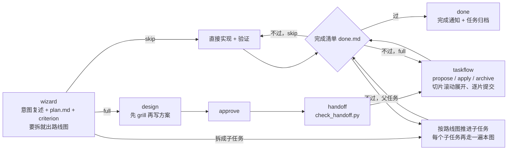

# task 系列：一页地图

规则真源在各 skill 文件；本页与之冲突时以真源为准。契约总真源（阶段、档位、目录、术语）：[skills/taskrail/references/contract.md](../../skills/taskrail/references/contract.md)。

task 系列只做三件事：**按步骤把任务做完且符合预期**（taskrail）、**先理解意图**（taskrail 的意图确认）、**用人话交流**（user-report）。

## 谁干什么

| skill | 一句话 |
|---|---|
| `taskrail` | 唯一编排入口：绑定 `tasks/` 台账，按阶段推进，按完成清单收口。意图确认（只读探索 → 1–3 句口语复述 → 纠偏到确认）、拆分（路线图）、design（先 grill 自问自答，再写方案）、approve、handoff 都是它的阶段细则 |
| `taskflow` | 交接后执行：建 `{task}-driver`，拆 OpenSpec change，子 change 按依赖滚动展开、逐片提交，进度只认 checkbox |
| `role-based-reviewer` | 可选的岗位化只读评审 |

## 流程



## 两个档位

| 档位 | 什么时候 | wizard 之后 |
|---|---|---|
| `skip` | 局部修改，一句话说得清 | 直接实现 + 验证 → done |
| `full` | 其余 | design → approve → handoff → propose → apply → archive → done |

旧任务里的 `simple` 按 `skip` 读，`medium` / `complex` 按 `full` 读，`phase: explore` 按 `design` 读。

## 大任务怎么拆

默认不拆。要分几块才能验收时，wizard 出一张路线图（每项一句话目标、子判据、依赖），和意图复述放在同一条消息里看一次：

- **切片（默认）**：同一份交付、能在同一条分支上合入的，拆成一个 driver 下的几片。propose 只展开依赖已满足的那批；每做完一片提交一次，过一次检查点（补拆、合并、改顺序，不停人）；后面的切片按已经落地的代码起草。
- **子任务**：要分别交付、或在不同仓库、且互不用对方代码的，才拆成子任务，目录在父任务的 `subtasks/{子任务}/` 下，和父任务的方案、审批文件分开。子任务沿用父任务的意图，方案没超出路线图那一行就不停；全部做完后，父任务验一次总判据才算做完。
- **续跑**：恢复时报「N 个里做完了 M 个」；说「继续」就取依赖已满足的下一项。

## human 与 goal

| | human（默认） | goal（`/goal` 或 `goal:`） |
|---|---|---|
| 停几次 | wizard 定稿时看意图复述和计划要点（拆了的连路线图一起看）；full 档 approve 时看方案，子任务在路线图范围内不再停。说「继续」即放行，其余阶段说决定接着做 | 不停，另一个模型审，收敛就继续 |
| 意图 | 你看复述，说对或指出哪里不对 | 另一个模型按清单审，最多两轮 |
| 一定停下 | 删数据、改共享配置、线上 / 对外发送、改完成标准、缺凭据或只有你知道的信息 | 同左 |

## 按需才读的包

- Web UI：`taskrail/references/ui-delivery.md`
- 质量画像 / 打分：`taskrail/references/quality-appendix.md`
- 多 worker 并行：`taskflow/references/multi-worker.md`
- 拆分（路线图、切片、子任务、续跑）：`taskrail/references/large-scope.md`
- 台账并发写：`taskrail/references/ledger-concurrency.md`

## 怎么用

```text
taskrail <一句话目标>          # 新任务（human）
taskrail goal: <一句话目标>    # 新任务（goal）
taskrail intent <一句话目标>   # 只确认理解对不对，不建任务
taskrail resume [slug]         # 恢复
taskrail list                  # 列任务
```

## FAQ

- **会问很多吗？** 不会。有取舍就按推荐定下并说一句理由，只有上表「一定停下」的情况才停。规则：`taskrail/references/user-report.md`。
- **它会没看资料就猜吗？** 不会。先读一手资料，能查到的不问；你纠正后先重查再改。见 `taskrail/references/intent.md`。
- **自己定的事我怎么知道？** 难回头的单独一行「我定了 X，因为 Y」，全部记在 `TASK.md`「已做决定」。
- **怎么算做完？** `taskrail/references/done.md` 逐条核对。
- **做完之后呢？** 发一条完成通知：判据怎么验的、改动在哪、主工作树里另有什么、合入时怎么落地；任务目录同轮归档。见 `user-report.md` 第 8 节。
- **要好看的界面怎么验收？** 加一条观感验收：goal 下另一个模型对照参照审截图自己迭代，human 下评审过了再给你看截图。见 `done.md`「观感验收」。
