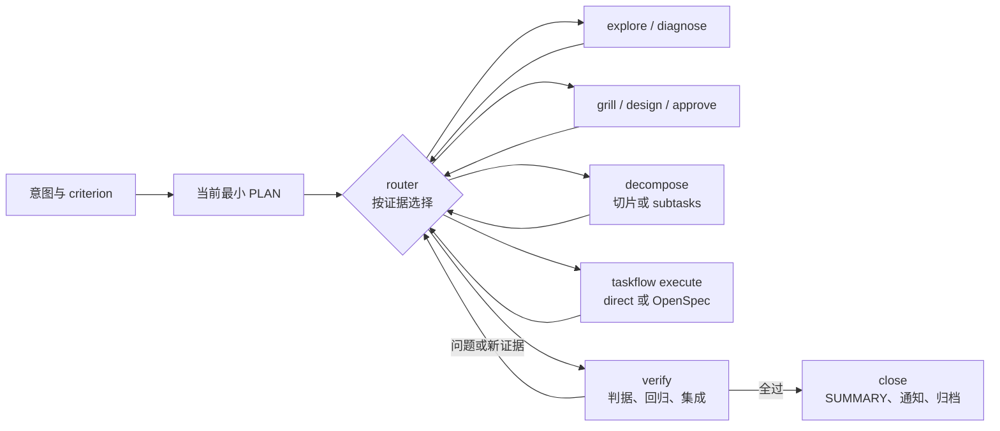

# task 系列：动态任务轨道与使用方式

规则真源在 `skills/taskrail/` 和 `skills/taskflow/`；本页是给人读的使用说明。契约总真源：[taskrail contract](../../skills/taskrail/references/contract.md)。

task 系列解决四件事：**任务有可持续更新的文档**、**代码在真正的 git worktree 中隔离**、**环节按证据动态选择**、**完成必须由验证与知识收口证明**。

## 1. 两个 Skill 的分工

| Skill | 职责 |
|---|---|
| `taskrail` | 唯一编排入口：workspace 绑定、意图与 criterion、动态 references、自动拆分、父子任务、恢复、验证、总结与归档 |
| `taskflow` | 代码执行与隔离：为每个修改仓准备 git worktree；按选择走 direct 或 OpenSpec；滚动实施、提交和留下证据 |
| `role-based-reviewer` | 按需的岗位化只读评审，不是每个任务的固定环节 |

固定主干只有：**目标与 criterion → 当前最小计划 → 动态 references → verify → close**。中间没有 `skip/full` 两条固化流程。



## 2. 四个相互独立的选择

| 维度 | 可选动作 | 判断依据 |
|---|---|---|
| 当前 reference | explore、diagnose、grill、design、approve、decompose 等的 enter / skip / reopen | 当前最关键不确定性、已有产物和失效证据 |
| 交付结构 | 不拆、切片、子任务 | 是否必须原子落地、能否按契约独立实施验证、交付节奏与集成边界 |
| 执行适配器 | direct、OpenSpec | 是否需要正式 change / 长期 spec / 跨会话编排产物，而不是任务看起来大不大 |
| 确认方式 | human、goal | human 在意图、实施方案等停点明确确认；goal 简要复述并按需异源审；不改变路由和执行方式 |

所有 git 代码修改默认都使用任务 worktree。`direct` 不等于“直接在源仓改”，`goal` 也不等于“自动 OpenSpec”。

## 3. workspace 与任务目录

workspace 是统一规划根，可以是多项目工作目录，也可以本身就是项目仓库；项目 checkout 可在 workspace 内外。

```text
<workspace>/
├── tasks/
│   ├── INDEX.md                       # 派生索引，不手改状态
│   ├── ongoing/<task-id>/
│   │   ├── TASK.md                    # 热状态：目标、criterion、当前/下一动作、repo 与产物指针
│   │   ├── PLAN.md                    # 当前最小计划与验证策略
│   │   ├── ROADMAP.md                 # 仅拆分：依赖、交付边界、集成项
│   │   ├── context/current.md         # 当前有效事实、假设与认知状态
│   │   ├── context/sources.md         # 按需：证据索引
│   │   ├── design/                    # 按需：grill、契约、ADR、设计
│   │   ├── reviews/                   # 按需：approve / review
│   │   ├── evidence/                  # 按需：复现、测试、集成证据或指针
│   │   ├── decisions.md               # 决定与 superseded 关系
│   │   ├── history.md                 # 冷历史：路由、状态迁移、更正
│   │   ├── SUMMARY.md                 # close 产出
│   │   └── subtasks/<child-id>/       # 子任务，结构同父；只拆一层
│   └── archive/<yyyy-mm-dd>/<task-id>/
├── openspec/                          # 仅 OpenSpec：driver 与子 changes
└── worktrees/<task-id>/<repo-id>/     # 每个修改仓的 git worktree
```

进度只认对应真源：

- `current_ref` 是当前动作，不是完成百分比。
- direct 看 PLAN checkbox；OpenSpec 看 change checkbox。
- 父子结构看 ROADMAP 与子 TASK，不在父 driver 再抄一份进度。
- INDEX 由脚本重建，不是第二状态源。

## 4. 日常使用

```text
taskrail <一句话目标>          # 新任务，默认 human
taskrail goal: <一句话目标>    # 新任务，goal 确认方式
taskrail intent <一句话目标>   # 只做意图确认；无任务目录时只在对话里复述
taskrail resume [task-id]      # 校核并恢复；拆过的任务取下一就绪项
taskrail explain [task-id]     # 只读解释当前环节、跳过/重入理由和下一动作
taskrail list                  # 查看任务索引
```

### 例 A：明确小改，direct

“把按钮文案‘提交’改成‘保存’，并跑相关测试。”

默认 human 的可能路径：只读目标处 → 复述意图与 criterion 并等确认 → 写最小 PLAN 并等实施确认 → 跳过 explore / diagnose / grill / design / approve / decompose → 在任务 worktree 走 direct → 验证 → close。不会仅因步骤少就跳过测试，也不会创建 driver。

### 例 B：原因不明的失败，先 diagnose

“最近导出经常超时，帮我修好。”

默认 human 下，意图确认后先固定版本、输入和环境，留下复现与基线 → 证明原因 → 必要时 explore 或 grill → 形成并确认实施方案 → 实施 → 回归与性能对比。改动小不能作为跳过根因证据的理由；连续失败没有新证据时会换动作，而不是盲试。

### 例 C：跨项目需求，自动 subtasks + 按需 OpenSpec

“让 Web 可以下载后台异步生成的报表，两边分别验收，最后跑通主流程。”

可能路径：先明确共享契约和总判据 → `decompose` 写 ROADMAP，立即创建 API、Web 等轻量 pending 子任务和父集成项 → 按依赖激活就绪项 → 每个子任务独立选择 direct 或 OpenSpec、各自有 worktree → 全部子任务 done 后父任务做跨仓集成和总判据验证。

有代码依赖不必然只能切片：必须同次原子落地的放在同一任务分支做切片；能按冻结契约独立交付的可作为有依赖子任务。子任务内部再拆只能是切片。

### 例 D：继续与解释

`resume` 先跑 `reconcile`，再核对任务、ROADMAP、worktree 和 driver 身份。默认只读热状态和当前 reference 所需产物；不会把全部历史、兄弟子任务和原始日志灌回上下文。`explain` 只读说明为什么在当前环节、哪些环节已跳过或重入、接下来做什么。

## 5. 动态 references 怎么选

| 信号 | 动作 |
|---|---|
| 改点、依赖、约束或影响面未知 | explore；已有当前 commit 证据可跳过 |
| bug、性能或 flaky 原因未证明 | diagnose；明确文案 / 配置错误可跳过 |
| 多个方案有实质外部取舍或约束冲突 | grill；普通可逆选择直接决定 |
| 契约、数据、架构或迁移变化 | design；完全沿用现有模式可跳过 |
| 用户要求审批、难逆高风险或重要外部行为变化 | approve；普通可逆且用户未要求可跳过 |
| 多交付、多项目、增量反馈或一次难回归 | decompose；一个连贯改动可跳过 |
| 高风险、公共契约、安全 / 性能敏感 | review；小且可逆改动可在 execute 自检 |
| 实施产物就绪 | verify，代码任务不可跳过 |
| 验证全过 | close，不可跳过 |

每个 reference 都有进入条件、跳过条件、所需输入、产出、完成门和重入规则。重入只修订受影响产物；相同输入没有新证据时不得重复完整动作。

## 6. worktree 的实际行为

每个必须修改的仓库都由同一入口准备：

```bash
python3 <taskflow>/scripts/prepare_worktree.py <workspace> <task-id> <repo-id> <source-repo> [--base <ref>] [--json]
```

- 分支为 `task/<task-id>`，每个仓库各有一个同名但相互独立的任务分支。
- 默认基线是有效 `origin/HEAD`，否则 `HEAD`；不自动 fetch。
- 注册表在 `worktrees/<task-id>/registry.json`，用于多仓登记和崩溃恢复。
- 干净已有 worktree 可恢复；脏 worktree、source / branch 身份冲突、未登记同名分支会非零退出并保留现场。
- 源 checkout 的分支和未提交修改保持原样；未提交输入不会自动复制。
- 只有 worktree 位于 source 内时才写 `.git/info/exclude`，不改项目 `.gitignore`。
- 不自动 push、合默认分支或清理 worktree。

非 git 目录或用户明确要求就地修改才可例外，并须记录决定与证据。

## 7. direct 与 OpenSpec

### direct

按 TASK / PLAN 的当前步骤实施，不建 driver，不走 handoff 门。适合不需要正式 OpenSpec 产物的任务；仍需 worktree、验证和 close。human 进入实施前当前 PLAN 必须已确认，goal 需已简要复述。

### OpenSpec

只有该路径在创建 driver 前运行：

```bash
python3 <taskflow>/scripts/check_handoff.py <workspace> <task-path>
```

新任务要求 `status: active`、`execution: openspec`、执行相关的 `current_ref`、非空 criterion 和匹配的 driver。需要 approve 时读取批准文件；router 判定无需 approve 时，交接节必须写 `批准：not-required: <具体理由>`。旧 `handed-off + phase` 任务仍可兼容校验。

driver 和子 changes 都在 workspace；子 change 按依赖滚动展开，全勾、`validate --strict`、提交和评审校核完成后才归档。**driver 归档后仍回 taskrail verify / close，不直接 done。**

## 8. human、goal 与停点

- human：新意图形成或变更后等明确确认；首次 execute 前或实施方案实质变化后再次等明确确认；router 选中 approve 时也等放行。有效且已确认的 resume 不重复停。
- goal：意图与 PLAN 简要复述且不等用户；需审阅时及 router 选中 approve 时由另一个模型审阅收敛，派不出时记录降级自审，不能宣称异源通过。
- 未命中停点的 reference 切换、片间检查点和就绪子任务切换，两种模式都用 1–2 句说明目前结果与下一动作，继续且不等回复；复述不算用户确认。
- 两种模式都不会自动放行删除迁移数据、共享配置、线上 / 不可逆 / 对外发送、改 criterion、缺凭据等真阻塞。
- 子任务在父 ROADMAP 和子判据范围内不重复停意图或 approve；human 子任务首次 execute 前仍确认自己的 PLAN，超范围才重入 intent / approve。

## 9. 进度、知识与认知更正

每次动作后更新热状态和 INDEX，路由原因追加 history，决定写 decisions。`close` 写 SUMMARY：结果与验证、最终机制 / 根因、被推翻假设、关键决定、可复用经验、剩余风险和合入方式。

用户改目标或新证据推翻认知时：

1. 回 intent 按确认协议重新确认意图 / criterion，并使受影响的 PLAN 确认失效。
2. 旧认知标 `refuted` / `superseded`，保留当前结论与证据。
3. 只使受影响的计划、设计和未勾项失效，不重写无关历史。
4. 已归档 OpenSpec 历史不改；需要时新增修订子 change。

TASK 约 6 KB、`context/current.md` 约 8 KB 是压缩软预算；超出后下沉冷内容，保留判据、当前事实和证据指针。

## 10. 完成与旧任务恢复

`status: done` 必须同时满足：当前代码证据证明 criterion、用户限制与交付标准满足、评审处置完毕、所有直接子任务 done、父集成与总判据通过、SUMMARY 完整。完成后发一次通知并同轮归档任务整树；不会自动 push 或合并。

旧任务里的 `phase/tier/status` 只作为历史元信息按现有产物兼容理解，不映射回固定双流程。伪造 `done` 缺 SUMMARY 或子任务未完成时，`reconcile --repair` 会修回 `active / close`；driver 已归档本身绝不会推出任务 done。

按需细则：

- 动态路由：`taskrail/references/router.md`
- 自动拆分：`taskrail/references/decompose.md`
- worktree：`taskflow/references/worktree.md`
- 确认停点：`taskrail/references/confirm-protocol.md`
- 完成清单：`taskrail/references/done.md`
- Web UI：`taskrail/references/ui-delivery.md`
- 多 worker：`taskflow/references/multi-worker.md`
